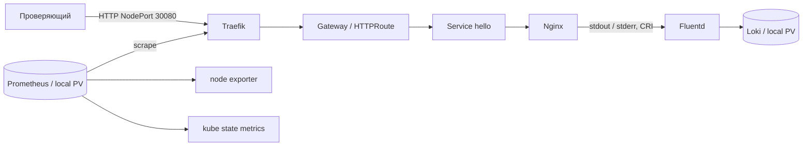

# Self-Verifying Kubernetes Stack

Nginx возвращает `Hello World!` через Traefik и Kubernetes Gateway API.
Prometheus измеряет HTTP и состояние узла, Fluentd доставляет access/error
логи в Loki. `make verify` связывает HTTP-ответ и access-log одним Request-ID
и отдельно подтверждает увеличение агрегированного HTTP counter.

Реализация MVP в работе. Статус проверок и принятая ревизия публикуются в
[реестре](docs/status.md) и [отчетах](docs/reports). До чистой приемки
MVP-06 этот README не является заявлением о завершенной приемке.



Одна Ubuntu VM, kubeadm, containerd, Calico VXLAN; без домашнего registry,
NAS, DNS или внешнего LoadBalancer. Proxmox применяется только для получения
нашего тестового стенда. Эксперту он не нужен.

| Компонент | Версия |
| --- | --- |
| Ubuntu | 24.04 LTS, amd64 |
| Kubernetes / kubeadm / kubelet / kubectl | 1.34.3 |
| containerd / runc / CNI plugins | 1.7.28 / 1.3.3 / 1.8.0 |
| Calico | 3.31.2 |
| Gateway API Standard CRDs | 1.4.0 |
| Traefik / Helm chart | 3.6.2 / 37.4.0 |
| Nginx unprivileged | 1.28.0-alpine |
| kube-prometheus-stack / Operator / Prometheus | 80.6.0 / 0.87.1 / 3.8.1 |
| node exporter / kube state metrics | 1.10.2 / 2.17.0 |
| Loki / Fluentd image | 3.6.2 / grafana/fluent-plugin-loki:3.6.2 |
| Fluentd runtime | 1.19.0 |
| Helm / Ansible core | 3.19.0 / 2.19.3 |

[Версии и SHA256](config/versions.yaml), [все image digests](config/images.lock.yaml),
[зависимости Python](requirements.txt). Образы применяются по digest; новый
image, отсутствующий в lock, останавливает deploy. Config reloader оператора
также закреплен. Plugin Loki встроен в Fluentd image, включается через
`-p /fluentd/plugins`; локальная сборка образов не требуется.

## Подготовка

Нужны чистая Ubuntu 24.04 amd64 VM с 4 vCPU, 8 GiB RAM, диском 60 GiB,
SSH-пользователь с `sudo -n`, доступ к публичным Ubuntu/Kubernetes repositories,
GitHub, Docker Hub, quay.io и registry.k8s.io. Это начальный размер; измерения
чистой приемки будут в `docs/acceptance/`. На VM не должно быть другого
Kubernetes/CNI. Примерные CIDR `10.244.0.0/16` и `10.96.0.0/12` должны
не пересекаться с вашими сетями/VPN.

Можно установить обычный Ubuntu Server 24.04 из ISO или использовать
официальный Ubuntu 24.04 cloud image. Подготовка VM не требует Kubernetes
ресурсов. Задайте стабильный IP/hostname и SSH public key; приватный ключ
остается на управляющей машине. Не открывайте NodePort в Internet для MVP.

На управляющей Ubuntu 24.04 (это может быть та же VM при доступном SSH):

```bash
sudo apt-get update
sudo apt-get install -y git make python3 python3-venv openssh-client
cd <checkout>
make tools
cp config/environments/ubuntu.example.yaml config/environments/ubuntu.local.yaml
```

Отредактируйте только локальный environment: имя/IP узла, SSH host/user/port,
путь к вашему ключу, kubeconfig и непересекающиеся CIDR. Этот файл игнорируется
Git. Все команды запускайте из корня репозитория. SSH host key нужно проверить
и принять до bootstrap обычным SSH-подключением. `make tools` устанавливает
инструменты в `.venv` и `.cache/tools`, без Nix и без root на управляющей машине.

До установки должен проходить `ssh <user>@<VM> sudo -n true`. На VM необходимы
исходящий HTTPS/DNS/NTP; с управляющей машины — SSH, Kubernetes API TCP 6443
и HTTP TCP 30080. Для одноузлового стенда сетевой overlay остается внутри VM;
дополнительные узлы в MVP не поддерживаются.

## Установка и проверка

```bash
make lint
make bootstrap ENV=ubuntu
make deploy ENV=ubuntu
make verify ENV=ubuntu
make verify-idempotency ENV=ubuntu
make evidence ENV=ubuntu
```

Bootstrap готовит ОС, swap/sysctl, containerd, kubeadm, Calico и каталоги
local PV. Чужой или частично созданный кластер не сбрасывается автоматически.
Deploy устанавливает storage, CRDs, Prometheus Operator и monitoring,
Traefik, ServiceMonitor, Loki/Fluentd, Nginx и Gateway. Конфигурация Kubernetes
создается автоматизацией; ручные `kubectl apply/edit` для установки не нужны.

`make verify` явно выбирает kubeconfig из environment, открывает временные
loopback port-forward к Prometheus/Loki и закрывает их при завершении.
Отчет всегда сохраняется в `artifacts/verify/<run-id>/report.json`, в том
числе при отказе. Код 0 означает успех всех обязательных проверок:

- Ready node/workloads и Bound PVC; актуальные Gateway/HTTPRoute conditions.
- HTTP 200 и ровно 12 bytes `Hello World!`, совпадающий Request-ID; fallback
  для невалидного ID, отрицательный маршрут и настоящий missing-file 404.
- Живые targets Traefik/node exporter/kube state metrics/Prometheus, свежие
  samples, рост scoped counter после нагрузки без незамеченного reset.
- Точная запись access с тем же Request-ID и независимая stderr error-запись
  через Loki API, правильные stream и source labels.
- Реальные UID PID1, отсутствие capabilities/API token и read-only root mount.

`PROFILE=final` пока возвращает ошибку: сетевые политики, TLS, canary,
автооткат, Grafana/Alertmanager и CI относятся к следующему этапу.

Повторный `make bootstrap` проверяет прежнюю идентичность узла. Команда
`verify-idempotency` дважды запускает deploy, сравнивает UIDs ресурсов,
PVC bindings и содержимое существующих прикладных secrets, каждый раз
выполняет полный verify. Helm release history исключена из сравнения.
`make evidence` упаковывает JSON-отчеты; kubeconfig/inventory/Secrets не собирает.

## Ручная диагностика

Используйте kubeconfig именно этого стенда:

```bash
export KUBECONFIG="$PWD/.state/ubuntu/admin.kubeconfig"
export PATH="$PWD/.cache/tools:$PATH"
kubectl get nodes
kubectl get pods -A
kubectl get gatewayclass
kubectl -n demo get gateway,httproute
curl -i -H 'X-Request-ID: manual-check-01' http://<VM_IP>:30080/
```

Метрики (отдельный терминал для port-forward):

```bash
kubectl -n monitoring port-forward --address=127.0.0.1 service/monitoring-prometheus 9090:9090
curl -s http://127.0.0.1:9090/api/v1/targets
curl -sG http://127.0.0.1:9090/api/v1/query \
  --data-urlencode 'query=traefik_entrypoint_requests_total{entrypoint="web",code="200",method="GET"}'
```

Логи (еще один терминал):

```bash
kubectl -n logging port-forward --address=127.0.0.1 service/loki 3100:3100
curl -sG http://127.0.0.1:3100/loki/api/v1/query_range \
  --data-urlencode 'query={app="hello",namespace="demo",stream="stdout"} |= "manual-check-01"'
```

Для stderr отправьте `GET /verify/missing/manual-error-01` через тот же NodePort
и найдите `manual-error-01` с `stream="stderr"`. `kubectl logs` показывает
локальный контейнер и не является доказательством доставки во Fluentd/Loki.
Request-ID хранится в записи, а не в metric/Loki labels.

| Симптом | Диагностика и следующий шаг |
| --- | --- |
| ImagePullBackOff | `kubectl describe pod -n <ns> <pod>`; проверить доступ к публичному registry и image lock, повторить deploy |
| Недостаточно CPU/RAM | `kubectl describe node`; увеличить VM, не удалять requests ради прохождения |
| PVC Pending | `kubectl get pv,pvc -A`; сверить node affinity, имя узла, volumeName и storageClass |
| CRD/condition ошибка | `kubectl -n demo describe gateway,httproute`; проверить закрепленную матрицу и порядок deploy |
| Target down/absent | `/api/v1/targets`, ServiceMonitor labels, `kubectl -n edge get svc traefik-metrics -o yaml` |
| Loki не находит marker | `kubectl -n logging logs ds/fluentd --tail=100`; проверить CRI путь, stream, buffer и Loki Ready |
| Bootstrap отказал на существующем кластере | Сверить identity и прошлый failed task; исправить причину, автоматического reset нет |
| Verify неуспешен | JSON содержит конкретный check; ограниченные events лежат рядом, затем повторить тот же verify |

## Ограничения

Single-node без HA. Local PV с Retain сохраняют данные при пересоздании pod,
но не защищают от потери диска/VM; резервное копирование не реализовано.
Retention Prometheus 24h/4GB, Loki 24h, два PV по 12Gi. Fluentd имеет
persistent positions и ограниченный буфер, допускает дубли; отсутствие
потерь при произвольной длительности outage не обещается. HTTP без TLS,
endpoint рассчитан на контролируемую тестовую сеть. Prometheus/Loki —
ClusterIP, доступны для диагностики через loopback port-forward.

Правила работы — [AGENTS.md](AGENTS.md), технические параметры —
[контракт](docs/contracts.md), исходные требования —
[план](docs/implementation-plan.md) и [карточки](docs/agent-sessions.md).
