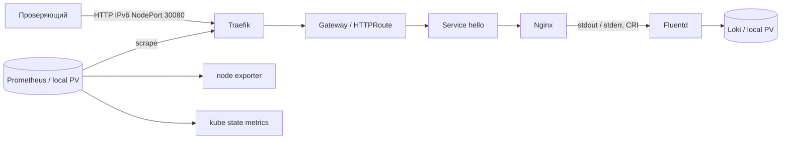

# Self-Verifying Kubernetes Stack

Nginx возвращает `Hello World!` через Traefik и Kubernetes Gateway API.
Prometheus измеряет HTTP и состояние узла, Fluentd доставляет access/error
логи в Loki. `make verify` связывает HTTP-ответ и access-log одним Request-ID
и отдельно подтверждает увеличение агрегированного HTTP counter.

MVP с IPv6 принят на Ubuntu 24.04.5, кодовая ревизия
`232964fc1cc6642f563225e4768f5964cde94e5f`.
Чистая установка выполнена на `fd67893`; финальная поправка касается
только проверки proxy и повторно проверена на обоих стендах.
[Независимая IPv6-приемка](docs/acceptance/ipv6-acceptance.md),
[сетевой контракт и переход с IPv4](docs/networking-ipv6.md),
[реестр](docs/status.md), [черновик паспорта](docs/passport/mvp-draft.md).
[Первоначальная IPv4-приемка](docs/acceptance/mvp-acceptance.md) сохранена
как история прежней ревизии `337d0c6`.
Этап FINAL не начат.



Одна Ubuntu VM, kubeadm, containerd, Calico VXLAN; без домашнего registry,
NAS, DNS или внешнего LoadBalancer. Proxmox применяется только для получения
нашего тестового стенда. Эксперту он не нужен.

| Компонент | Версия |
| --- | --- |
| Ubuntu | 24.04 LTS, amd64 |
| Kubernetes / kubeadm / kubelet / kubectl | 1.34.3 |
| containerd / runc / CNI plugins | 1.7.28 / 1.3.3 / 1.8.0 |
| Calico | 3.31.2 |
| Gateway API Standard CRDs | 1.4.0 |
| Traefik / Helm chart | 3.6.2 / 37.4.0 |
| Nginx unprivileged | 1.28.0-alpine |
| kube-prometheus-stack / Operator / Prometheus | 80.6.0 / 0.87.1 / 3.8.1 |
| node exporter / kube state metrics | 1.10.2 / 2.17.0 |
| Loki / Fluentd image | 3.6.2 / grafana/fluent-plugin-loki:3.6.2 |
| Fluentd runtime | 1.19.0 |
| Helm / Ansible core | 3.19.0 / 2.19.3 |

[Версии и SHA256](config/versions.yaml), [все image digests](config/images.lock.yaml),
[зависимости Python](requirements.txt). Образы применяются по digest; новый
image, отсутствующий в lock, останавливает deploy. Config reloader оператора
также закреплен. Plugin Loki встроен в Fluentd image, включается через
`-p /fluentd/plugins`; локальная сборка образов не требуется.

## Подготовка

Нужны чистая Ubuntu 24.04 amd64 VM с 4 vCPU, 8 GiB RAM, диском 60 GiB,
SSH-пользователь с `sudo -n`, доступ к публичным Ubuntu/Kubernetes repositories,
GitHub, Docker Hub, quay.io и registry.k8s.io. Управляющей машине также нужны
PyPI/files.pythonhosted.org, get.helm.sh, dl.k8s.io и Helm chart repositories.
Этот размер проверен чистой приемкой; минимальная конфигурация не определялась.
На VM не должно быть другого
Kubernetes/CNI. Примерные CIDR `fd4d:5453:1000:100::/56` и
`fd4d:5453:1000:200::/112` должны
не пересекаться с вашими сетями/VPN.

Можно установить обычный Ubuntu Server 24.04 из ISO или использовать
официальный Ubuntu 24.04 cloud image. Подготовка VM не требует Kubernetes
ресурсов. Задайте стабильный IP/hostname и SSH public key; приватный ключ
остается на управляющей машине. Нужны маршрутизируемый IPv6 узла (ULA или
GUA), рабочие IPv6 DNS/NTP и IPv6 на управляющей машине, включая `::1`.
IPv4 у ОС допускается только для внешней загрузки пакетов/образов.
Не открывайте NodePort в Internet для MVP.

На управляющей Ubuntu 24.04 (это может быть та же VM при доступном SSH):

```bash
sudo apt-get update
sudo apt-get install -y git make curl python3 python3-venv openssh-client
cd <checkout>
make tools
cp config/environments/ubuntu.example.yaml config/environments/ubuntu.local.yaml
```

Отредактируйте только локальный environment: имя/IP узла, SSH host/user/port,
путь к вашему ключу, kubeconfig, IPv6 DNS/NTP и непересекающиеся IPv6 CIDR.
`node_ip` и `ssh_host` задавайте без скобок; URL содержит IPv6 в `[скобках]`.
Этот файл игнорируется
Git. Все команды запускайте из корня репозитория. SSH host key нужно проверить
и принять до bootstrap обычным SSH-подключением. `make tools` устанавливает
инструменты в `.venv` и `.cache/tools`, без Nix и без root на управляющей машине.

До установки должен проходить `ssh -6 <user>@<VM_IPv6> sudo -n true`. На VM необходимы
исходящий HTTPS/DNS/NTP; с управляющей машины — SSH, Kubernetes API TCP 6443
и HTTP TCP 30080 по IPv6. Для одноузлового стенда сетевой overlay остается внутри VM;
дополнительные узлы в MVP не поддерживаются.

В первоначальной IPv4-приемке путь от `make tools` до первого успешного `make verify`
занял 5 минут 54 секунды; весь прогон с повторным bootstrap и двумя deploy —
8 минут 56 секунд. Создание VM и установка системных prerequisites сюда не
входят. После проверки ОС видела 7,76 GiB RAM, доступно было 5,87 GiB;
диск занимал 6,12 GiB, свободно 50,94 GiB. CPU busy за 30 секунд — 3,89%.
Это снимок после проверки, не пик нагрузки или нагрузочный тест.
Точные измерения и длительности — в [evidence](docs/acceptance/mvp-clean-vm.json).

## Установка и проверка

```bash
make lint
make bootstrap ENV=ubuntu
make deploy ENV=ubuntu
make verify ENV=ubuntu
make verify-idempotency ENV=ubuntu
make evidence ENV=ubuntu
```

Bootstrap готовит ОС, swap/sysctl, containerd, kubeadm, Calico и каталоги
local PV. Чужой или частично созданный кластер не сбрасывается автоматически.
Deploy устанавливает storage, CRDs, Prometheus Operator и monitoring,
Traefik, ServiceMonitor, Loki/Fluentd, Nginx и Gateway. Конфигурация Kubernetes
создается автоматизацией; ручные `kubectl apply/edit` для установки не нужны.

`make verify` явно выбирает kubeconfig из environment, открывает временные
IPv6 loopback port-forward к Prometheus/Loki и закрывает их при завершении.
Для обязательного аудита сокетов ему также нужен SSH по IPv6 и `sudo -n`
из того же environment; отсутствие доступа дает ошибку проверки.
Отчет всегда сохраняется в `artifacts/verify/<run-id>/report.json`, в том
числе при отказе. Код 0 означает успех всех десяти проверок, покрывающих:

- Ready node/workloads и Bound PVC; актуальные Gateway/HTTPRoute conditions.
- Фактические IPv6 API/InternalIP/Pod/Service/EndpointSlice и единственный
  Calico IPv6 pool; IPv4/mapped IPv4/dual-stack не проходят проверку.
- HTTP 200 и ровно 12 bytes `Hello World!`, совпадающий Request-ID; fallback
  для невалидного ID, отрицательный маршрут и настоящий missing-file 404.
- Живые targets Traefik/node exporter/kube state metrics/Prometheus, свежие
  samples, рост scoped counter после нагрузки без наблюдаемого уменьшения counter.
- Точная запись access с тем же Request-ID и независимая stderr error-запись
  через Loki API, правильные stream и source labels.
- Реальные UID PID1, отсутствие capabilities/API token и read-only root mount.
- Сокеты узла и Pod, включая TIME-WAIT: нет IPv4 соединений стека;
  Prometheus/Loki отклоняют IPv4 loopback; активный NTP-сервер использует IPv6.
  Исключение ОС для публичного HTTP(S)/локального DNS определяется адресом
  и портом, без анализа содержимого загрузки.

`PROFILE=final` пока возвращает ошибку: сетевые политики, TLS, canary,
автооткат, Grafana/Alertmanager и CI относятся к следующему этапу.

Повторный `make bootstrap` проверяет прежнюю идентичность узла. Команда
`verify-idempotency` дважды запускает deploy, сравнивает UIDs ресурсов,
PVC bindings и содержимое существующих прикладных secrets, каждый раз
выполняет полный verify. Helm release history исключена из сравнения.
`make evidence` упаковывает JSON-отчеты; kubeconfig/inventory/Secrets не собирает.

На выделенном тестовом стенде `make verify-recovery ENV=ubuntu` проверяет
сохранение истории Prometheus/Loki при пересоздании pod и доставку пяти
маркеров из буфера после короткой остановки Loki и рестарта Fluentd.
Команда восстанавливает одну реплику Loki и завершает сценарий обычным verify.
Контролируемый reboot VM проверяется последующими `make health ENV=ubuntu`
и `make verify ENV=ubuntu`.
Запускайте health после завершения загрузки ОС и startup hooks API.
Служба kubelet в состоянии `activating` или еще неготовый `/readyz` дают
ненулевой код; после завершения запуска проверку нужно повторить.

## Ручная диагностика

Используйте kubeconfig именно этого стенда:

```bash
unset HTTP_PROXY HTTPS_PROXY ALL_PROXY http_proxy https_proxy all_proxy
export KUBECONFIG="$PWD/.state/ubuntu/admin.kubeconfig"
export PATH="$PWD/.cache/tools:$PATH"
kubectl get nodes
kubectl get pods -A
kubectl get gatewayclass
kubectl -n demo get gateway,httproute
curl -6 --noproxy '*' -g -i -H 'X-Request-ID: manual-check-01' 'http://[<VM_IPv6>]:30080/'
```

Метрики (отдельный терминал для port-forward):

```bash
kubectl -n monitoring port-forward --address=::1 service/monitoring-prometheus 9090:9090
curl -6 --noproxy '*' -gs 'http://[::1]:9090/api/v1/targets'
curl -6 --noproxy '*' -gsG 'http://[::1]:9090/api/v1/query' \
  --data-urlencode 'query=traefik_entrypoint_requests_total{namespace="edge",service="traefik-metrics",endpoint="metrics",entrypoint="web",code="200",method="GET"}'
```

Логи (еще один терминал):

```bash
kubectl -n logging port-forward --address=::1 service/loki 3100:3100
curl -6 --noproxy '*' -gsG 'http://[::1]:3100/loki/api/v1/query_range' \
  --data-urlencode 'query={app="hello",namespace="demo",stream="stdout"} |= "manual-check-01"'
```

Для stderr отправьте `GET /verify/missing/manual-error-01` через тот же NodePort
и найдите `manual-error-01` с `stream="stderr"`. `kubectl logs` показывает
локальный контейнер и не является доказательством доставки во Fluentd/Loki.
Request-ID хранится в записи, а не в metric/Loki labels.

| Симптом | Диагностика и следующий шаг |
| --- | --- |
| ImagePullBackOff | `kubectl describe pod -n <ns> <pod>`; проверить доступ к публичному registry и image lock, повторить deploy |
| Недостаточно CPU/RAM | `kubectl describe node`; увеличить VM, не удалять requests ради прохождения |
| PVC Pending | `kubectl get pv,pvc -A`; сверить node affinity, имя узла, volumeName и storageClass |
| CRD/condition ошибка | `kubectl -n demo describe gateway,httproute`; проверить закрепленную матрицу и порядок deploy |
| Target down/absent | `/api/v1/targets`, ServiceMonitor labels, `kubectl -n edge get svc traefik-metrics -o yaml` |
| Loki не находит marker | `kubectl -n logging logs ds/fluentd --tail=100`; проверить CRI путь, stream, buffer и Loki Ready |
| Bootstrap отказал на существующем кластере | Сверить identity и прошлый failed task; исправить причину, автоматического reset нет |
| Verify неуспешен | JSON содержит конкретный check; ограниченные events лежат рядом, затем повторить тот же verify |

## Ограничения

Single-node без HA. Local PV с Retain сохраняют данные при пересоздании pod,
но не защищают от потери диска/VM; резервное копирование не реализовано.
Емкость local PV не устанавливает filesystem-квоту на каталог узла.
Retention Prometheus 24h/4GB, Loki 24h, два PV по 12Gi. Fluentd имеет
persistent positions и ограниченный буфер, допускает дубли; отсутствие
потерь при произвольной длительности outage не обещается. HTTP без TLS,
endpoint рассчитан на контролируемую тестовую сеть. Prometheus/Loki —
ClusterIP, доступны для диагностики через loopback port-forward.

Правила работы — [AGENTS.md](AGENTS.md), технические параметры —
[контракт](docs/contracts.md), исходные требования —
[план](docs/implementation-plan.md) и [карточки](docs/agent-sessions.md).
