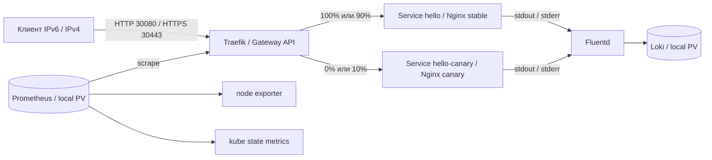

# Self-Verifying Kubernetes Stack

Учебный DevOps-проект для MTC ENGINEER HACK: Nginx в Kubernetes, публикация
через Gateway API, метрики в Prometheus и логи в Loki через Fluentd.
Установка выполняется одной командой. Отдельная проверка отправляет запросы,
проверяет ответы, прирост HTTP-счетчика и доставку access/error-логов.

Дополнительно реализованы IPv6/IPv4, HTTPS с локальной CA, выпуск canary
с распределением 90/10 и автоматический возврат на stable при ошибках.
Проект разработан с использованием ИИ по требованиям автора; решения
и исправления описаны в [истории разработки](docs/development.md).

## Архитектура



Одна Ubuntu VM: kubeadm, containerd и Calico VXLAN. Traefik использует
`GatewayClass`, `Gateway` и `HTTPRoute`; приложение доступно через NodePort.
Prometheus и Loki остаются внутри кластера, для диагностики используется
port-forward. Публичное доменное имя, частный registry и облачный балансировщик
для стенда не нужны; образы скачиваются из публичных registry.

| Компонент | Версия |
| --- | --- |
| Ubuntu | 24.04 LTS, amd64; проверено на 24.04.5 |
| Kubernetes / kubeadm / kubelet / kubectl | 1.34.3 |
| containerd / runc / CNI plugins | 1.7.28 / 1.3.3 / 1.8.0 |
| Calico | 3.31.2 |
| Gateway API Standard CRDs | 1.4.0 |
| Traefik / Helm chart | 3.6.2 / 37.4.0 |
| Nginx unprivileged | 1.28.0-alpine |
| kube-prometheus-stack / Operator / Prometheus | 80.6.0 / 0.87.1 / 3.8.1 |
| node exporter / kube state metrics | 1.10.2 / 2.17.0 |
| Loki / Fluentd image | 3.6.2 / grafana/fluent-plugin-loki:3.6.2 |
| Fluentd runtime | 1.19.0 |
| Helm / Ansible core | 3.19.0 / 2.19.3 |

Версии и SHA-256 находятся в [versions.yaml](config/versions.yaml), образы —
в [images.lock.yaml](config/images.lock.yaml), Python-зависимости —
в [requirements.txt](requirements.txt). Установка использует image digests;
образ, которого нет в lock-файле, будет отклонен.

## Требования

- Чистая Ubuntu 24.04 amd64: 4 vCPU, 8 GiB RAM, диск 60 GiB. Это проверенная
  конфигурация, минимальные ресурсы отдельно не определялись.
- SSH-пользователь с `sudo -n`; завершенный cloud-init при использовании cloud image.
- Стабильный IPv4 узла; для режима `dual-stack` также нужен IPv6. Рабочие
  DNS/NTP. Подсети Pod и Service не должны
  пересекаться с локальной сетью и VPN. [Подробности сети](docs/networking.md).
- Управляющая Ubuntu 24.04 с доступом к выбранным семьям адресов.
  Для `ipv4` достаточно IPv4 и `127.0.0.1`; для `dual-stack` нужен также `::1`.
  Ею может быть сама VM, если настроено SSH-подключение к ней.
- Доступ к Ubuntu repositories, pkgs.k8s.io, GitHub, Docker Hub, quay.io,
  registry.k8s.io, PyPI/files.pythonhosted.org, get.helm.sh и dl.k8s.io.
  С управляющей машины нужны SSH, API 6443, HTTP 30080 и HTTPS 30443.

VM можно установить из ISO или официального Ubuntu cloud image. Установщик
не создает VM и не меняет сеть гипервизора. На узле не должно быть чужого
Kubernetes или CNI. Приложение рассчитано на контролируемую тестовую сеть.

## Установка

1. Передайте checkout на управляющую машину или клонируйте репозиторий.
   Если Git еще не установлен: `sudo apt-get update && sudo apt-get install -y git`.
2. Из корня проекта создайте локальную конфигурацию:

   ```bash
   cp config/environments/ubuntu.example.yaml config/environments/ubuntu.local.yaml
   ```

   **Если на новой VM нет IPv6**, используйте другой пример:

   ```bash
   cp config/environments/ubuntu-ipv4.example.yaml config/environments/ubuntu.local.yaml
   ```

   В нем задано `network_mode: ipv4`, а `node_ip` — IPv4 VM. `node_ipv4`
   можно не указывать: он равен `node_ip`. IPv6-адреса, IPv6-маршрут и даже
   поддержка IPv6 в ядре не нужны. DNS/NTP укажите IPv4-адресами.

   Режим по умолчанию — `network_mode: dual-stack`: IPv6 `node_ip`, IPv4 `node_ipv4`.
   Укажите имя узла, адреса выбранного режима, SSH host/user/key/port,
   путь к kubeconfig, DNS/NTP и свободные Pod/Service CIDR. Файл игнорируется Git.
   Адреса в YAML записываются без квадратных скобок.
3. Проверьте SSH host key и доступ: `ssh <user>@<VM> sudo -n true`.
4. Запустите:

   ```bash
   bash scripts/deploy.sh --env ubuntu
   ```

Скрипт установит недостающие системные зависимости, создаст `.venv`, скачает
закрепленные Helm/kubectl, затем настроит ОС, containerd, Kubernetes, Calico
и компоненты приложения. CA и TLS-сертификат создаются автоматически.
При наличии make можно использовать `make deploy ENV=ubuntu`.
Для другого имени конфигурации передайте соответствующий `--env` или `ENV`.

Отдельный запуск bootstrap перед deploy не требуется. Ошибка на этом этапе
останавливает установку. Повторный запуск проверяет принадлежность кластера
заданному environment; автоматического сброса чужого кластера нет.
Сетевой режим выбирается перед первой установкой. Менять его у существующего
кластера нельзя: проверка identity остановит установку; нужна чистая VM.

## Проверка

```bash
make lint
make health ENV=ubuntu
make verify-release ENV=ubuntu
make verify-idempotency ENV=ubuntu
make evidence ENV=ubuntu
```

`verify-release` проверяет готовность компонентов, сети выбранного режима, HTTP, TLS,
Prometheus, Fluentd/Loki и ограничения процесса Nginx. `make verify ENV=ubuntu`
запускает базовую часть без расширенных TLS-маршрутов. JSON-отчеты сохраняются
в `artifacts/`, в том числе при ошибке. Ненулевой код означает провал проверки;
`make evidence` собирает отчеты в архив.

`verify-idempotency` дважды повторяет bootstrap и deploy, сравнивает UID
ресурсов, привязки PVC и содержимое Secrets, затем снова проверяет сервис.
TLS-сертификаты при повторном deploy сохраняются.

Быстрая внешняя проверка — ожидается HTTP 200 и ровно `Hello World!`:

```bash
curl -6 --noproxy '*' -g -i -H 'X-Request-ID: manual-check-01' 'http://[<VM_IPv6>]:30080/'
curl -4 --noproxy '*' -i -H 'X-Request-ID: manual-check-02' 'http://<VM_IPv4>:30080/'
curl --noproxy '*' --cacert .state/tls/ubuntu/ca.crt --resolve 'hello.test:30443:[<VM_IPv6>]' 'https://hello.test:30443/'
```

В режиме `ipv4` используйте IPv4-команду HTTP, а для HTTPS:

```bash
curl -4 --noproxy '*' --cacert .state/tls/ubuntu/ca.crt --resolve 'hello.test:30443:<VM_IPv4>' 'https://hello.test:30443/'
```

В ответе присутствуют `X-Request-ID`, `X-Release` и `X-Revision`.
Как проверить targets Prometheus, выполнить запрос метрик и найти эти
Request-ID в Loki — в [инструкции по эксплуатации](docs/operations.md).

## Canary и восстановление

После установки stable имеет две replicas и 100% трафика; canary — одну
replica и 0%. Пути `/backend/stable` и `/backend/canary` проверяют каждый
backend отдельно. Для выпуска новой ревизии и возврата:

```bash
make deploy-canary ENV=ubuntu CANARY_ARGS="--revision demo-v2"
make verify-release ENV=ubuntu
make restore-stable ENV=ubuntu
```

Кандидат сначала проверяется без общего трафика, затем получает 10% запросов.
За 60 секунд проверяются HTTP-ответы и метрики его backend: не менее 100
запросов, не более 1% 5xx, свежие samples. Параметры — в
[config/canary.yaml](config/canary.yaml). Неверное тело ответа, ошибки или
недостаток данных приводят к возврату 100/0 и ненулевому коду выпуска.
Обычный deploy также возвращает 100/0 и здоровую базовую конфигурацию.

На тестовом стенде доступны `make verify-canary`, `make verify-interruption`
и `make demo` с `ENV=ubuntu`. Они намеренно создают отказы и восстанавливают
рабочее состояние. Reboot запускается с внешней управляющей машины:
`make demo ENV=ubuntu DEMO_ARGS="--section reboot"`.
[Сценарии и результаты](docs/verification.md).

## Проверенный результат и ограничения

4 октября 2026 года (МСК) завершен полный прогон `ipv4` на новой Ubuntu VM
с отключенным в ядре IPv6 (`ipv6.disable=1`). Чистая установка — **6 мин 33 с**;
прошли HTTP/TLS, метрики/логи, два повторных deploy, canary/rollback,
прерывание выпуска, восстановление данных и reboot. Из 195 локальных тестов
193 прошли, два теста IPv6 loopback пропущены из-за отсутствия IPv6.
На отдельной Ubuntu с IPv6 прошли все 195 тестов и сквозная проверка
существующего dual-stack стенда новым кодом.
[Протокол IPv4-only](docs/verification.md#ipv4-only-на-vm-без-ipv6) и
[машинный отчет](docs/evidence/ipv4-validation.json).

3 октября 2026 года выполнены две установки на чистые Ubuntu VM: **5 мин 12 с**
и **5 мин 45 с**. Пройдены 180 локальных тестов, проверки HTTP/TLS, метрик,
логов, повторного deploy и reboot. В первом полном прогоне дополнительно
проверены canary, откат, прерывание выпуска и восстановление данных после
замены pod. [Протокол и машинные результаты](docs/verification.md).

Один узел не обеспечивает HA. Local PV сохраняют данные при замене pod,
но не при потере диска; backup не реализован. Prometheus хранит данные
24 часа с пределом 4 GB, Loki — 24 часа; каждый PV имеет capacity 12 GiB,
которая не является файловой квотой. Буфер Fluentd ограничен; возможны дубли
и потеря непрочитанных логов при длительном сбое и ротации файлов.

TLS использует локальную CA без автоматической ротации. NetworkPolicy,
Grafana/Alertmanager и CI с временным кластером в эту версию не входят.
Поддерживается `PROFILE=mvp`; зарезервированный `PROFILE=final` возвращает
ошибку. Canary проверяется в рамках операции выпуска, непрерывного
контроллера отката нет.

## Документация

- [План работ](docs/implementation-plan.md) и [история решений и правок](docs/development.md).
- [Устройство компонентов](docs/architecture.md), [сеть](docs/networking.md),
  [эксплуатация](docs/operations.md).
- [Результаты проверок](docs/verification.md) и [паспорт решения](docs/passport.pdf)
  ([исходник для печати](docs/passport.html)).
- Настройки компонентов: [Ansible](ansible/README.md),
  [Gateway](deploy/gateway/README.md), [мониторинг](deploy/monitoring/README.md),
  [логи](deploy/logging/README.md).
