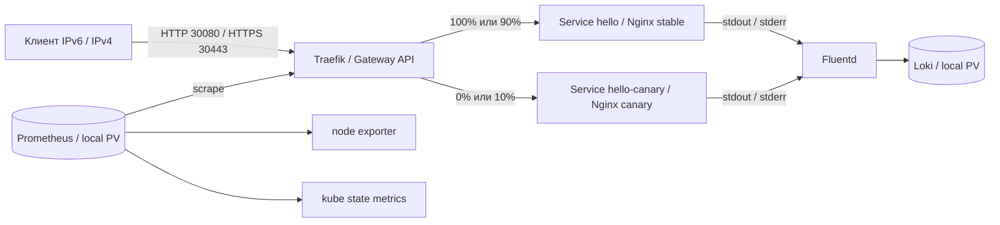

# Self-Verifying Kubernetes Stack

Учебный DevOps-проект для MTC ENGINEER HACK: Nginx в Kubernetes, публикация
через Gateway API, метрики в Prometheus и логи в Loki через Fluentd.
Установка выполняется одной командой. Отдельная проверка отправляет запросы,
проверяет ответы, прирост HTTP-счетчика и доставку access/error-логов.

Дополнительно реализованы IPv6/IPv4, HTTPS с локальной CA, выпуск canary
с распределением 90/10 и автоматический возврат на stable при ошибках.
Проект разработан с использованием ИИ по требованиям автора.
Обоснования реализации описаны в [технических решениях](docs/decisions.md).

## Архитектура



Одна Ubuntu VM: kubeadm, containerd и Calico VXLAN. Traefik использует
`GatewayClass`, `Gateway` и `HTTPRoute`; приложение доступно через NodePort.
Prometheus и Loki остаются внутри кластера, для диагностики используется
port-forward. Публичное доменное имя, частный registry и облачный балансировщик
для стенда не нужны; образы скачиваются из публичных реестров.

| Компонент | Версия |
| --- | --- |
| Ubuntu | 24.04 LTS, amd64; проверено на 24.04.5 |
| Kubernetes / kubeadm / kubelet / kubectl | 1.34.3 |
| containerd / runc / CNI plugins | 1.7.28 / 1.3.3 / 1.8.0 |
| Calico | 3.31.2 |
| Gateway API Standard CRDs | 1.4.0 |
| Traefik / Helm chart | 3.6.2 / 37.4.0 |
| Nginx unprivileged | 1.28.0-alpine |
| kube-prometheus-stack / Operator / Prometheus | 80.6.0 / 0.87.1 / 3.8.1 |
| node exporter / kube state metrics | 1.10.2 / 2.17.0 |
| Loki / Fluentd image | 3.6.2 / grafana/fluent-plugin-loki:3.6.2 |
| Fluentd runtime | 1.19.0 |
| Helm / Ansible core | 3.19.0 / 2.19.3 |

Версии и SHA-256 находятся в [versions.yaml](config/versions.yaml), образы —
в [images.lock.yaml](config/images.lock.yaml), Python-зависимости —
в [requirements.txt](requirements.txt). Установка использует image digests;
образ, которого нет в lock-файле, будет отклонен.

## Требования

- Чистая Ubuntu 24.04 amd64: 4 vCPU, 8 GiB RAM, диск 60 GiB. Это проверенная
  конфигурация, минимальные ресурсы отдельно не определялись. Bootstrap требует
  корневую файловую систему `/` размером **не менее 50 GiB** и свободное место
  на ней **не менее 35 GiB** при первой установке, **10 GiB** при повторной.
  Проверяйте `df -h /`: размер всего диска не равен размеру корневого раздела.
- На целевой VM: SSH-пользователь с `sudo -n`; завершенный cloud-init
  при использовании cloud image.
- Стабильный IPv4 узла; для режима `dual-stack` также нужен IPv6. Рабочие
  DNS/NTP. Подсети Pod и Service не должны
  пересекаться с локальной сетью и VPN. [Подробности сети](docs/networking.md).
- Управляющая Ubuntu 24.04 с доступом к выбранным семьям адресов.
  Для `ipv4` достаточно IPv4 и `127.0.0.1`; для `dual-stack` нужен также `::1`.
  Ею может быть сама VM, если настроено SSH-подключение к ней.
  Для автоматической установки недостающих системных пакетов на управляющей
  машине также нужен `sudo -n` (либо запуск от root). Если такого доступа нет,
  администратор может заранее установить `ca-certificates make curl openssl
  python3 python3-venv openssh-client`; дальнейшие команды выполняются
  обычным пользователем с правом записи в каталог проекта.
- Доступ к репозиториям Ubuntu, pkgs.k8s.io, GitHub, Docker Hub, quay.io,
  registry.k8s.io, PyPI/files.pythonhosted.org, get.helm.sh и dl.k8s.io.
  С управляющей машины нужны SSH, API 6443, HTTP 30080 и HTTPS 30443.

VM можно установить из ISO или официального Ubuntu cloud image. Установщик
не создает VM и не меняет сеть гипервизора. На узле не должно быть чужого
Kubernetes или CNI. Приложение рассчитано на контролируемую тестовую сеть.

## Установка

1. Передайте исходники на управляющую машину через `scp`, распакуйте архив
   или клонируйте репозиторий. Для установки, проверок, canary и сборки отчётов
   Git и каталог `.git` не нужны; установщик не устанавливает Git.
   При обновлении исходников сохраняйте локальную конфигурацию
   `config/environments/<ENV>.local.yaml` и каталог `.state/`.
2. Из корня репозитория создайте локальную конфигурацию для выбранного режима.
   Для VM с IPv6 и IPv4:

   ```bash
   cp config/environments/ubuntu.example.yaml config/environments/ubuntu.local.yaml
   ```

   **Если на новой VM нет IPv6**, используйте другой пример:

   ```bash
   cp config/environments/ubuntu-ipv4.example.yaml config/environments/ubuntu.local.yaml
   ```

   В нем задано `network_mode: ipv4`, а `node_ip` — IPv4 VM. `node_ipv4`
   можно не указывать: он равен `node_ip`. IPv6-адреса, IPv6-маршрут и даже
   поддержка IPv6 в ядре не нужны. DNS/NTP укажите IPv4-адресами.

   Режим по умолчанию — `network_mode: dual-stack`: IPv6 `node_ip`, IPv4 `node_ipv4`.
   Укажите имя узла, адреса выбранного режима, SSH host/user/key/port,
   путь к kubeconfig, DNS/NTP и свободные Pod/Service CIDR. Файл игнорируется Git.
   Адреса в YAML записываются без квадратных скобок.
3. Проверьте SSH-доступ с теми же ключом, портом, пользователем и адресом,
   которые заданы в `ssh_private_key_file`, `ssh_port`, `ssh_user`, `ssh_host`:

   ```bash
   ssh -i ~/.ssh/id_ed25519 -p 22 ubuntu@192.0.2.10 sudo -n true
   ```

   Замените значения в примере на значения своего YAML. При первом подключении
   сверьте fingerprint ключа сервера перед его добавлением в `known_hosts`.
   Команда должна завершиться с кодом 0. На отдельной управляющей машине
   также проверьте локальный `sudo -n true`, если установщику предстоит
   устанавливать системные пакеты.
4. Запустите:

   ```bash
   bash scripts/deploy.sh --env ubuntu
   ```

Скрипт устанавливает недостающие системные зависимости, создает `.venv`, скачивает
закрепленные Helm/kubectl, затем настраивает ОС, containerd, Kubernetes, Calico
и компоненты приложения. CA и TLS-сертификат создаются автоматически.
При наличии make можно использовать `make deploy ENV=ubuntu`.
Для другого имени конфигурации передайте соответствующий `--env` или `ENV`.

Отдельный запуск bootstrap перед deploy не требуется. Ошибка на этом этапе
останавливает установку. Повторный запуск проверяет принадлежность кластера
выбранному окружению; автоматического сброса чужого кластера нет.
Сетевой режим выбирается перед первой установкой. Менять его у существующего
кластера нельзя: проверка параметров кластера остановит установку; нужна чистая VM.

## Проверка приложения

```bash
make lint
make health ENV=ubuntu
make verify-release ENV=ubuntu
make verify-idempotency ENV=ubuntu
make evidence ENV=ubuntu
```

`verify-release` проверяет готовность компонентов, сети выбранного режима, HTTP, TLS,
Prometheus, Fluentd/Loki и ограничения процесса Nginx. `make verify ENV=ubuntu`
запускает базовую часть без расширенных TLS-маршрутов. JSON-отчеты сохраняются
в `artifacts/`, в том числе при ошибке. Ненулевой код означает провал проверки;
`make evidence` собирает отчеты в архив.

Поля отчёта `revision` и `working_tree_dirty` содержат Git-метаданные,
если исходники находятся в Git-репозитории и Git доступен. В копии без `.git`
или без установленного Git оба поля равны `null`; это не ошибка проверки.
Проверки ревизии приложения в `X-Revision` и состояния Helm от Git не зависят.

`verify-idempotency` дважды повторяет bootstrap и deploy, сравнивает UID
ресурсов, привязки PVC и содержимое Secrets, затем снова проверяет сервис.
TLS-сертификаты при повторном deploy сохраняются.

Быстрая внешняя проверка — ожидается HTTP 200 и ровно `Hello World!`:

```bash
curl -6 --noproxy '*' -g -i -H 'X-Request-ID: manual-check-01' 'http://[<VM_IPv6>]:30080/'
curl -4 --noproxy '*' -i -H 'X-Request-ID: manual-check-02' 'http://<VM_IPv4>:30080/'
curl --noproxy '*' --cacert .state/tls/ubuntu/ca.crt --resolve 'hello.test:30443:[<VM_IPv6>]' 'https://hello.test:30443/'
```

В режиме `ipv4` используйте IPv4-команду HTTP, а для HTTPS:

```bash
curl -4 --noproxy '*' --cacert .state/tls/ubuntu/ca.crt --resolve 'hello.test:30443:<VM_IPv4>' 'https://hello.test:30443/'
```

В ответе присутствуют `X-Request-ID`, `X-Release` и `X-Revision`.
Маршрут `/unrouted` возвращает 404 от Gateway.

## Проверка мониторинга

Prometheus собирает HTTP-счетчики и длительность запросов Traefik, CPU/RAM
узла через node exporter, состояние Kubernetes через kube state metrics
и собственные метрики. Автоматическая проверка `make verify ENV=ubuntu`
проверяет доступность targets, свежесть данных и прирост HTTP-счетчика.

Для ручной проверки выберите kubeconfig из локальной конфигурации:

```bash
KUBECONFIG="$(.venv/bin/python -c 'import sys; sys.path.insert(0, "scripts"); from stacklib import environment; print(environment("ubuntu")["kubeconfig"])')" || exit 1
test -s "$KUBECONFIG" || exit 1
export KUBECONFIG
export PATH="$PWD/.cache/tools:$PWD/.venv/bin:$PATH"
kubectl -n monitoring port-forward --address=127.0.0.1 service/monitoring-prometheus 9090:9090
```

Оставьте port-forward работающим, а в другом терминале выполните:

```bash
curl --noproxy '*' -fsS 'http://127.0.0.1:9090/api/v1/targets'
curl --noproxy '*' -fsSG 'http://127.0.0.1:9090/api/v1/query' \
  --data-urlencode 'query=traefik_entrypoint_requests_total{namespace="edge",service="traefik-metrics",endpoint="metrics",entrypoint="web",code="200",method="GET"}'
```

Ожидаются здоровые targets Traefik, node exporter, kube state metrics
и Prometheus. После HTTP-запросов к приложению и очередного сбора метрик
(интервал 15 секунд) счетчик увеличивается. Пустой результат запроса
не считается успешной проверкой. Для CPU и RAM доступны
`node_cpu_seconds_total` и `node_memory_MemAvailable_bytes`.

## Проверка логирования

Fluentd собирает access-логи Nginx из stdout и error-логи из stderr
и передает их в Loki. Автоматическая проверка `make verify ENV=ubuntu`
отправляет запросы и находит соответствующие записи в Loki.

Для ручной проверки отправьте запросы через Gateway:

```bash
curl -4 --noproxy '*' -i -H 'X-Request-ID: manual-log-01' 'http://<VM_IPv4>:30080/'
curl -4 --noproxy '*' -i 'http://<VM_IPv4>:30080/verify/missing/manual-error-01'
```

Первый запрос возвращает 200, второй — 404 и запись об отсутствующем файле.
В терминале с настроенным выше kubeconfig откройте port-forward к Loki
(завершите предыдущий через Ctrl+C или используйте отдельный терминал):

```bash
kubectl -n logging port-forward --address=127.0.0.1 service/loki 3100:3100
```

В другом терминале найдите обе записи:

```bash
curl --noproxy '*' -fsSG 'http://127.0.0.1:3100/loki/api/v1/query_range' \
  --data-urlencode 'query={app="hello",namespace="demo",stream="stdout"} |= "manual-log-01"'
curl --noproxy '*' -fsSG 'http://127.0.0.1:3100/loki/api/v1/query_range' \
  --data-urlencode 'query={app="hello",namespace="demo",stream="stderr"} |= "manual-error-01"'
```

Access-запись содержит Request-ID `manual-log-01`, метод GET, URI `/`
и status 200; error-запись — имя отсутствующего файла `manual-error-01`.
Ручной port-forward на `127.0.0.1` работает в обоих сетевых режимах.
Дополнительные команды — в [инструкции по эксплуатации](docs/operations.md).

## Canary и восстановление

После установки stable имеет две реплики и 100% трафика; canary — одну
реплику и 0%. Пути `/backend/stable` и `/backend/canary` проверяют каждый
backend отдельно. Для выпуска новой ревизии и возврата:

```bash
make deploy-canary ENV=ubuntu CANARY_ARGS="--revision demo-v2"
make verify-release ENV=ubuntu
make restore-stable ENV=ubuntu
```

Кандидат сначала проверяется без общего трафика, затем получает 10% запросов.
За 60 секунд проверяются HTTP-ответы и метрики его backend: не менее 100
запросов, не более 1% 5xx, свежие samples. Параметры — в
[config/canary.yaml](config/canary.yaml). Неверное тело ответа, ошибки или
недостаток данных приводят к возврату 100/0 и ненулевому коду выпуска.
Обычный deploy также возвращает 100/0 и здоровую базовую конфигурацию.

На тестовом стенде доступны `make verify-canary`, `make verify-interruption`
и `make demo` с `ENV=ubuntu`. Они намеренно создают отказы и восстанавливают
рабочее состояние. Перезагрузка проверяется с внешней управляющей машины:
`make demo ENV=ubuntu DEMO_ARGS="--section reboot"`.
[Сценарии и результаты](docs/verification.md).

## Дополнительные возможности

| Возможность | Реализация | Проверка |
| --- | --- | --- |
| Два сетевых режима | `dual-stack` с основным IPv6 или `ipv4` без поддержки IPv6 | `make health`, `make verify` |
| Расширенный Gateway API | Четыре HTTPRoute, hostname/path, URLRewrite, HTTPS и два backend | `make verify-release` |
| Canary и автоматический откат | Распределение 90/10, проверка HTTP и метрик, возврат 100/0 | `make verify-canary` |
| Восстановление | Прерывание выпуска, замена Pod, сохранение истории и буфера логов | `make demo`, отдельный сценарий reboot |
| Ограничения Nginx | UID 101, файловая система только для чтения, без capabilities и API token | `make verify` |
| Закрепленные зависимости | Версии, SHA-256 архивов и digest образов | `make lint` |

Все команды используют `ENV=ubuntu` или имя вашей локальной конфигурации.

## Результаты проверки

В сохраненном прогоне установка на чистой Ubuntu VM без IPv6 заняла
**6 мин 33 с**. Проверены HTTP/TLS, метрики и логи, два повторных развертывания,
canary и откат, прерывание выпуска, восстановление данных и перезагрузка.
Из 195 локальных тестов 193 прошли, два пропущены из-за отсутствия IPv6.
На Ubuntu с IPv6 прошли все 195 тестов и сквозная проверка dual-stack-кластера.

Для dual-stack также сохранены два прогона чистой установки: **5 мин 12 с**
и **5 мин 45 с**. Их состав, проверенные ревизии и ограничения приведены
в [результатах проверки](docs/verification.md). Это результаты конкретных
стендов; подготовка VM и SSH в длительность установки не входит.

## Ограничения

Один узел не обеспечивает HA. Local PV сохраняют данные при замене Pod,
но не при потере диска; резервное копирование не реализовано. Prometheus хранит данные
24 часа с пределом 4 GB, Loki — 24 часа; каждый PV имеет capacity 12 GiB,
которая не является файловой квотой. Буфер Fluentd ограничен; возможны дубли
и потеря непрочитанных логов при длительном сбое и ротации файлов.

TLS использует локальную CA без автоматической ротации. NetworkPolicy,
Grafana/Alertmanager и CI с временным кластером в эту версию не входят.
Базовая команда `make verify` поддерживает только `PROFILE=mvp`;
TLS и расширенные маршруты проверяет `make verify-release`.
Canary проверяется в рамках операции выпуска, непрерывного
контроллера отката нет.

## Документация

- [Технические решения](docs/decisions.md).
- [Архитектура](docs/architecture.md), [сеть](docs/networking.md),
  [эксплуатация](docs/operations.md).
- [Результаты проверок](docs/verification.md) и [паспорт проекта](docs/passport.pdf)
  ([исходник для печати](docs/passport.html)).
- Настройки компонентов: [Ansible](ansible/README.md),
  [Gateway](deploy/gateway/README.md), [мониторинг](deploy/monitoring/README.md),
  [логи](deploy/logging/README.md).
- [Соответствие заданию и формат сдачи](docs/submission.md).
