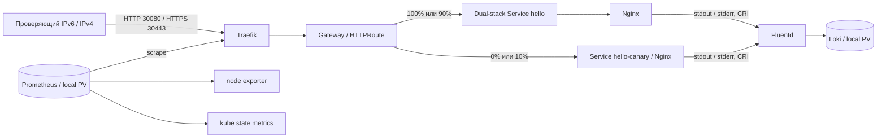

# Self-Verifying Kubernetes Stack

Nginx возвращает `Hello World!` через Traefik и Kubernetes Gateway API.
Prometheus измеряет HTTP и состояние узла, Fluentd доставляет access/error
логи в Loki. `make verify` связывает HTTP-ответ и access-log одним Request-ID
и отдельно подтверждает увеличение агрегированного HTTP counter.

MVP с полноценным dual-stack Kubernetes принят на чистой Ubuntu 24.04.5,
кодовая ревизия `cc3afc6cab06a4cb441c3f0c705e79cc04910a0f`.
После дополнительного аудита две проверки усилены; код `8ed0e70`
повторно проверен на рабочем стенде: lint, deploy/verify, recovery и обе сети
прошли. [Результаты аудита](docs/reports/MVP-AUDIT.md) отделены от прежней
чистой установки и ее измерений.
IPv6 — основной; приложение и компоненты доступны также по IPv4.
[Сетевой контракт и диагностика](docs/networking.md),
[независимая приемка](docs/acceptance/dual-stack-acceptance.md),
[реестр](docs/status.md), [черновик паспорта](docs/passport/mvp-draft.md).
Назначенные TLS/Gateway и выпуск canary с автооткатом приняты на `9ce5f99`:
[протокол FINAL-01/05](docs/reports/FINAL-INTEGRATION.md), [реестр](docs/status.md).
Остальные карточки FINAL не назначены. Полный профиль `PROFILE=final`
пока не поддерживается.



Одна Ubuntu VM, kubeadm, containerd, Calico VXLAN; без домашнего registry,
NAS, DNS или внешнего LoadBalancer. Proxmox применяется только для получения
нашего тестового стенда. Эксперту он не нужен.

| Компонент | Версия |
| --- | --- |
| Ubuntu | 24.04 LTS, amd64 |
| Kubernetes / kubeadm / kubelet / kubectl | 1.34.3 |
| containerd / runc / CNI plugins | 1.7.28 / 1.3.3 / 1.8.0 |
| Calico | 3.31.2 |
| Gateway API Standard CRDs | 1.4.0 |
| Traefik / Helm chart | 3.6.2 / 37.4.0 |
| Nginx unprivileged | 1.28.0-alpine |
| kube-prometheus-stack / Operator / Prometheus | 80.6.0 / 0.87.1 / 3.8.1 |
| node exporter / kube state metrics | 1.10.2 / 2.17.0 |
| Loki / Fluentd image | 3.6.2 / grafana/fluent-plugin-loki:3.6.2 |
| Fluentd runtime | 1.19.0 |
| Helm / Ansible core | 3.19.0 / 2.19.3 |

[Версии и SHA256](config/versions.yaml), [все image digests](config/images.lock.yaml),
[зависимости Python](requirements.txt). Образы применяются по digest; новый
image, отсутствующий в lock, останавливает deploy. Config reloader оператора
также закреплен. Plugin Loki встроен в Fluentd image, включается через
`-p /fluentd/plugins`; локальная сборка образов не требуется.

## Подготовка

Нужны чистая Ubuntu 24.04 amd64 VM с 4 vCPU, 8 GiB RAM, диском 60 GiB,
SSH-пользователь с `sudo -n`, доступ к публичным Ubuntu/Kubernetes repositories,
GitHub, Docker Hub, quay.io и registry.k8s.io. Управляющей машине также нужны
PyPI/files.pythonhosted.org, get.helm.sh, dl.k8s.io и Helm chart repositories.
Этот размер проверен чистой приемкой; минимальная конфигурация не определялась.
На VM не должно быть другого
Kubernetes/CNI. Примерные CIDR `fd4d:5453:1000:100::/56` и
`fd4d:5453:1000:200::/112`, `10.244.0.0/16` и `10.96.0.0/16` должны
не пересекаться с вашими сетями/VPN.

Можно установить обычный Ubuntu Server 24.04 из ISO или использовать
официальный Ubuntu 24.04 cloud image. Подготовка VM не требует Kubernetes
ресурсов. Задайте стабильные IPv6/IPv4 и hostname и SSH public key; приватный ключ
остается на управляющей машине. Нужны маршрутизируемый IPv6 узла (ULA или
GUA), IPv4 того же узла, рабочие DNS/NTP и обе семьи на управляющей машине, включая `::1`.
DNS/NTP могут использовать любую рабочую семью. IPv4 разрешен и для внутренних соединений.
Не открывайте NodePort в Internet для MVP.

На управляющей Ubuntu 24.04 (это может быть та же VM при доступном SSH)
нужны исходники проекта и настроенный локальный environment:

```bash
cd <checkout>
cp config/environments/ubuntu.example.yaml config/environments/ubuntu.local.yaml
```

Отредактируйте только локальный environment: имя узла, `node_ip` (основной IPv6), `node_ipv4`, SSH host/user/port,
путь к вашему ключу, kubeconfig, DNS/NTP и непересекающиеся CIDR обеих семей.
IP задавайте без скобок; URL содержит IPv6 в `[скобках]`.
Этот файл игнорируется
Git. Все команды запускайте из корня репозитория. SSH host key нужно проверить
и принять до bootstrap обычным SSH-подключением. Начальный deploy автоматически
устанавливает недостающие системные prerequisites управляющей Ubuntu через
`sudo -n apt-get`, затем закрепленные инструменты в `.venv` и `.cache/tools`.
Если prerequisites уже установлены, локальный root не нужен. Nix не требуется.
Для получения checkout через Git на чистой машине сначала установите Git:
`sudo apt-get update && sudo apt-get install -y git`; также можно передать
уже клонированный репозиторий. Kubernetes, containerd, Helm и Ansible заранее
устанавливать не нужно.

До установки должен проходить `ssh <user>@<VM> sudo -n true`. На VM необходимы
исходящий HTTPS/DNS/NTP; с управляющей машины — SSH, Kubernetes API TCP 6443
и HTTP TCP 30080 по IPv6 и IPv4. Для одноузлового стенда сетевой overlay остается внутри VM;
дополнительные узлы в MVP не поддерживаются.

В чистой dual-stack приемке путь от `make tools` до первого успешного
`make verify` занял 7 минут 8 секунд; весь прогон из 11 стадий, включая
повторный bootstrap, два повторных deploy и recovery, — 12 минут 9 секунд.
Создание VM и установка системных prerequisites сюда не входят.
После проверки ОС видела 7,76 GiB RAM, доступно было 5,86 GiB;
диск занимал 6,13 GiB, свободно 50,94 GiB. CPU busy за 30 секунд — 3,59%.
Это снимок после проверки, не пик нагрузки или нагрузочный тест.
Точные измерения и длительности — в [evidence](docs/acceptance/dual-stack-evidence.json).

## Установка и проверка

```bash
bash scripts/deploy.sh --env ubuntu
```

При наличии make эквивалентный вход — `make deploy ENV=ubuntu`.
Команда готовит локальные инструменты,
выполняет bootstrap чистой Ubuntu и устанавливает весь стек: Kubernetes,
containerd, Calico, storage, Gateway API/Traefik, Prometheus, Fluentd/Loki,
stable/canary Nginx и TLS. Отдельный `make bootstrap` перед deploy не требуется.
Bootstrap и установка компонентов выполняются последовательно под одной
блокировкой. Ошибка bootstrap останавливает установку; прежний kubeconfig
не используется для продолжения после ошибки.

После установки:

```bash
make lint
make verify ENV=ubuntu
make verify-release ENV=ubuntu
make verify-idempotency ENV=ubuntu
make evidence ENV=ubuntu
```

Bootstrap готовит ОС, swap/sysctl, containerd, kubeadm, Calico и каталоги
local PV. Чужой или частично созданный кластер не сбрасывается автоматически.
Deploy устанавливает storage, CRDs, Prometheus Operator и monitoring,
Traefik, ServiceMonitor, Loki/Fluentd, Nginx и Gateway. Конфигурация Kubernetes
создается автоматизацией; ручные `kubectl apply/edit` для установки не нужны.

`make verify` явно выбирает kubeconfig из environment, открывает временные
loopback port-forward к Prometheus/Loki и закрывает их при завершении.
Отчет всегда сохраняется в `artifacts/verify/<run-id>/report.json`, в том
числе при отказе. Код 0 означает успех всех 11 обязательных проверок:

- Ready node/workloads и Bound PVC; актуальные Gateway/HTTPRoute conditions.
- Основной IPv6 API, обе семьи Node/Pod и Calico pools; собственные Services
  RequireDualStack с IPv6 первым. У каждого Service проверяются Ready EndpointSlices
  обеих семей, связанные с теми же Pod UID. Точные системные исключения описаны в сетевом контракте.
- По обеим семьям HTTP 200 и ровно 12 bytes `Hello World!`, совпадающий Request-ID; fallback
  для невалидного ID, отрицательный маршрут и настоящий missing-file 404.
- Живые targets Traefik/node exporter/kube state metrics/Prometheus, свежие
  samples, отсутствие повторного scrape одного Pod/port/path через разные адреса или jobs,
  рост scoped counter после суммарной нагрузки по обеим семьям без уменьшения counter.
- Для каждого семейства точная запись access с тем же Request-ID и независимая stderr error-запись
  через Loki API, правильные stream и source labels.
- Реальные UID PID1, отсутствие capabilities/API token и read-only root mount.

`PROFILE=final` пока возвращает ошибку: сетевые политики, Grafana/Alertmanager
и CI еще не назначены. Принятые TLS/Gateway и canary проверяются через
`verify-release` и `verify-canary`.

Повторный `make bootstrap` проверяет прежнюю идентичность узла. Команда
`make deploy` повторяет тот же bootstrap перед обновлением компонентов.
`verify-idempotency` дважды запускает полный deploy, сравнивает UIDs ресурсов,
PVC bindings и содержимое существующих прикладных secrets, каждый раз
выполняет полный verify. Helm release history исключена из сравнения.
`make evidence` упаковывает JSON-отчеты; kubeconfig/inventory/Secrets не собирает.

На выделенном тестовом стенде `make verify-recovery ENV=ubuntu` проверяет
сохранение истории Prometheus/Loki при пересоздании pod и доставку пяти
маркеров из буфера после короткой остановки Loki и рестарта Fluentd.
Команда восстанавливает одну реплику Loki и завершает сценарий обычным verify.
Контролируемый reboot VM проверяется последующим `make health ENV=ubuntu`.
Запускайте health после завершения загрузки ОС: служба kubelet в состоянии
`activating` дает ненулевой код, после ее запуска проверку нужно повторить.

## Ручная диагностика

Используйте kubeconfig из выбранного локального environment, а не текущий
контекст kubectl. Ниже выбран `ubuntu`; при другом `ENV` замените имя в
`environment("ubuntu")`. Путь разрешается относительно корня репозитория:

```bash
KUBECONFIG="$(.venv/bin/python -c 'import sys; sys.path.insert(0, "scripts"); from stacklib import environment; print(environment("ubuntu")["kubeconfig"])')" || exit 1
test -s "$KUBECONFIG" || exit 1
export KUBECONFIG
export PATH="$PWD/.cache/tools:$PATH"
kubectl get nodes
kubectl get pods -A
kubectl get gatewayclass
kubectl -n demo get gateway,httproute
curl -6 --noproxy '*' -g -i -H 'X-Request-ID: manual-check-01' 'http://[<VM_IPv6>]:30080/'
curl -4 --noproxy '*' -i -H 'X-Request-ID: manual-check-v4' 'http://<VM_IPv4>:30080/'
```

Метрики (отдельный терминал для port-forward):

```bash
kubectl -n monitoring port-forward --address=::1 service/monitoring-prometheus 9090:9090
curl -6 --noproxy '*' -gs 'http://[::1]:9090/api/v1/targets'
curl -6 --noproxy '*' -gsG 'http://[::1]:9090/api/v1/query' \
  --data-urlencode 'query=traefik_entrypoint_requests_total{namespace="edge",service="traefik-metrics",endpoint="metrics",entrypoint="web",code="200",method="GET"}'
```

Логи (еще один терминал):

```bash
kubectl -n logging port-forward --address=::1 service/loki 3100:3100
curl -6 --noproxy '*' -gsG 'http://[::1]:3100/loki/api/v1/query_range' \
  --data-urlencode 'query={app="hello",namespace="demo",stream="stdout"} |= "manual-check-01"'
```

Для stderr отправьте `GET /verify/missing/manual-error-01` через тот же NodePort
и найдите `manual-error-01` с `stream="stderr"`. `kubectl logs` показывает
локальный контейнер и не является доказательством доставки во Fluentd/Loki.
Request-ID хранится в записи, а не в metric/Loki labels.

| Симптом | Диагностика и следующий шаг |
| --- | --- |
| ImagePullBackOff | `kubectl describe pod -n <ns> <pod>`; проверить доступ к публичному registry и image lock, повторить deploy |
| Недостаточно CPU/RAM | `kubectl describe node`; увеличить VM, не удалять requests ради прохождения |
| PVC Pending | `kubectl get pv,pvc -A`; сверить node affinity, имя узла, volumeName и storageClass |
| CRD/condition ошибка | `kubectl -n demo describe gateway,httproute`; проверить закрепленную матрицу и порядок deploy |
| Target down/absent | `/api/v1/targets`, ServiceMonitor labels, `kubectl -n edge get svc traefik-metrics -o yaml` |
| Loki не находит marker | `kubectl -n logging logs ds/fluentd --tail=100`; проверить CRI путь, stream, buffer и Loki Ready |
| Bootstrap отказал на существующем кластере | Сверить identity и прошлый failed task; исправить причину, автоматического reset нет |
| Verify неуспешен | JSON содержит конкретный check; ограниченные events лежат рядом, затем повторить тот же verify |

## TLS, два backend и выпуск canary

После `make deploy ENV=ubuntu` основной маршрут имеет веса stable/canary
100/0. Stable — `hello` (две replicas), canary — `hello-canary` (одна);
оба здоровых backend возвращают ровно `Hello World!`. Заголовки `X-Release`
и `X-Revision` показывают реально обслужившую запрос версию, `X-Traffic-Split`
— примененные Gateway веса. Canary обновляется через Recreate при нулевом
весе; stable использует rolling update с двумя replicas.
`/backend/stable` и `/backend/canary` проверяют каждый backend отдельно.
Hostname `hello.test` имеет собственный HTTPRoute. HTTPS доступен через
NodePort 30443; имя и порт можно задать как `tls_hostname` и
`https_node_port` в локальном environment.

```bash
make verify-release ENV=ubuntu
make deploy-canary ENV=ubuntu CANARY_ARGS="--revision demo-v2"
make verify-release ENV=ubuntu
make restore-stable ENV=ubuntu
make verify-canary ENV=ubuntu
make verify-interruption ENV=ubuntu
make demo ENV=ubuntu
# С внешней управляющей машины с явным kubeconfig — reboot тестовой VM:
make demo ENV=ubuntu DEMO_ARGS="--reboot"
# Только reboot + health/verify, если остальные demo-сценарии уже проверены:
make demo ENV=ubuntu DEMO_ARGS="--section reboot"
```

`deploy-canary` сначала подтверждает 100/0 и проверяет кандидата отдельным
маршрутом, затем подает ему 10% общего трафика. За ограниченное окно собирает
точные HTTP-ответы и метрики именно canary backend. Параметры в
`config/canary.yaml`: 60 секунд, не менее 100 canary запросов, не более 1% 5xx,
свежие samples. HTTP 200 с неверным телом тоже означает отказ.
При недоступных/устаревших метриках либо недостатке выборки результат
`inconclusive`, а не успех. При отказе выполняется возврат 100/0, проверка
stable-трафика и восстановление здоровой конфигурации кандидата. Команда
выпуска возвращает ненулевой код даже при успешном откате.

Успешный выпуск оставляет веса 90/10. `restore-stable` и обычный `deploy`
возвращают 100/0 и базового здорового кандидата: отклоненная версия при
повторном deploy не возвращается. Все изменения выполняются через Helm
под общей блокировкой. После interruption читается фактическое состояние;
для Helm `pending-*` восстанавливается завершенная ревизия (для Gateway —
только 100/0). Если безопасной ревизии нет, операция завершается явной ошибкой:
нужно исследовать `helm history` с тем же kubeconfig и восстановить известную
принятую ревизию; удаление Helm Secrets вручную не является штатным способом.

CA создается автоматически и хранится в `.state/tls/<ENV>/ca.crt`; повтор
deploy сохраняет сертификаты. Ключи не входят в Git. Проверка TLS без `-k`:

```bash
curl --noproxy '*' --cacert .state/tls/ubuntu/ca.crt \
  --resolve 'hello.test:30443:[<VM_IPv6>]' 'https://hello.test:30443/'
curl --noproxy '*' --cacert .state/tls/ubuntu/ca.crt \
  --resolve 'hello.test:30443:<VM_IPv4>' 'https://hello.test:30443/backend/canary'
```

`verify-canary` включает реальные тестовые версии с HTTP 500/неверным телом
после включения 90/10, отрицательный smoke до подачи трафика и сценарии
отсутствия/недостатка метрик. Он заканчивает восстановлением 100/0 и полным
`verify-release`. `demo` дополнительно проверяет замену app pod при трафике,
изменение версии конфигурации и Helm rollback, историю Prometheus/Loki и
буфер Fluentd. `verify-interruption` реально прерывает отдельный процесс выпуска
во время Helm upgrade и проверяет восстановление в том же и следующем запуске;
этот сценарий также входит в `demo`. Каждый сценарий сохраняет JSON в `artifacts/`; `make evidence`
включает и вложенные отчеты canary. Это fault-сценарии только для выделенного
тестового стенда, они временно изменяют его состояние.
Reboot запускается снаружи целевой VM, чтобы проверяющий процесс пережил
перезагрузку. Запуск этого сценария на самой VM отклоняется до изменения стенда.

`verify-release` объединяет проверки MVP и назначенного Gateway/TLS.
NetworkPolicy, Grafana, alerts и CI остаются отдельными неназначенными задачами;
поэтому `PROFILE=final` по-прежнему отклоняется. Выпуск canary — конечная
операция с окном наблюдения, не непрерывный контроллер отката.

## Ограничения

Single-node без HA. Local PV с Retain сохраняют данные при пересоздании pod,
но не защищают от потери диска/VM; резервное копирование не реализовано.
Емкость local PV не устанавливает filesystem-квоту на каталог узла.
Retention Prometheus 24h/4GB, Loki 24h, два PV по 12Gi. Fluentd имеет
persistent positions и ограниченный буфер, допускает дубли; отсутствие
потерь при произвольной длительности outage не обещается. HTTP сохраняется
наряду с HTTPS от локальной CA; автоматическое обновление сертификатов не
реализовано. Endpoint рассчитан на контролируемую тестовую сеть. Prometheus/Loki —
ClusterIP, доступны для диагностики через loopback port-forward.

Правила работы — [AGENTS.md](AGENTS.md), технические параметры —
[контракт](docs/contracts.md), исходные требования —
[план](docs/implementation-plan.md) и [карточки](docs/agent-sessions.md).
