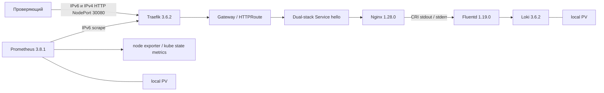

# Self-Verifying Kubernetes Stack — черновик паспорта MVP

Рабочий материал по структуре исходного задания. Финальный PDF, проверка
лимитов четырех страниц/15 МБ и архив относятся к отдельно назначаемой
сдаче. **Dual-stack MVP принят 2026-10-01**; кодовая ревизия
`cc3afc6cab06a4cb441c3f0c705e79cc04910a0f`, все 14 критериев pass.
Текущие критерии и результаты — в [dual-stack протоколе](../acceptance/dual-stack-acceptance.md).
[Первоначальная IPv4-приемка](../acceptance/mvp-acceptance.md) относится к
прежней версии. Незавершенная strict IPv6-only попытка заменена новым
пользовательским требованием; ее вердикт не переносится на dual-stack.

## Страница 1. Архитектура и состав

Одноузловой Kubernetes публикует Nginx с ответом `Hello World!` через
Gateway API. Проверенный режим — полноценный dual-stack с основным IPv6.
Чистая установка выполнена на Ubuntu 24.04.5 amd64: 4 vCPU, 8 GiB RAM,
диск 60 GiB. Повтор bootstrap/deploy, recovery и новый запуск основного
стенда прошли на принятой ревизии.
Proxmox использовался для создания тестовой VM, но не является зависимостью
развертывания. Коммерческие облачные сервисы и инфраструктура автора не нужны.

| Состав | Реализация |
| --- | --- |
| ОС и кластер | Ubuntu 24.04; kubeadm/Kubernetes 1.34.3; containerd 1.7.28; Calico 3.31.2 dual-stack VXLAN |
| Публикация | Gateway API Standard 1.4.0; Traefik 3.6.2 / chart 37.4.0; GatewayClass, Gateway, HTTPRoute |
| Приложение | Публичный Nginx unprivileged 1.28.0-alpine, ConfigMap и собственный Helm chart |
| Мониторинг | kube-prometheus-stack 80.6.0; Operator 0.87.1 создает Prometheus 3.8.1; node exporter 1.10.2, kube state metrics 2.17.0 |
| Логирование | Fluentd DaemonSet 1.19.0 с Loki plugin из image 3.6.2; Loki 3.6.2, filesystem TSDB/WAL |
| Автоматизация | Make, Python, Ansible core 2.19.3, Helm 3.19.0; версии/SHA256/image digests в репозитории |
| Хранение | Два local PV по 12Gi, Retain; persistent positions и buffer Fluentd на hostPath |

## Страница 2. Обязательные функции и проверка

| Пункт задания | Реализация и обоснование | Как проверить |
| --- | --- | --- |
| Kubernetes на Ubuntu 24.04 | Ansible готовит ОС/containerd, kubeadm создает кластер; отсутствие зависимости от облачного вендора | `make bootstrap ENV=ubuntu`, `make health ENV=ubuntu`: Node Ready, DNS и HTTP между pod |
| Две сети, IPv6 основной | Pod и собственные Services получают IPv6 и IPv4; основной kubeconfig, SSH-путь и Service IP — IPv6 | Verify проверяет адреса обеих семей, HTTP и access/error logs каждого пути; supplement — точные DNS A/AAAA и API обеих семей с проверкой TLS |
| HTTP-приложение | Nginx возвращает ровно 12 bytes, пишет JSON access в stdout и настоящие error в stderr; собственной бизнес-логики не требуется | `make verify ENV=ubuntu`; curl NodePort из README |
| Gateway API | Traefik, GatewayClass `mts-traefik`, Gateway `gateway`, HTTPRoute `hello`; backend — ClusterIP Service | Verify проверяет актуальные conditions, HTTP 200, `/verify`, 404 на unmatched route |
| Prometheus | ServiceMonitor собирают Traefik, node exporter, kube state metrics и Prometheus; видны HTTP и состояние узла | Verify проверяет уникальные targets без двойного scrape по двум семьям, свежие samples и прирост counter; ручные API queries в README |
| Fluentd и поиск логов | Collector читает CRI только Nginx, сохраняет stream/source, передает в Loki; централизованный поиск воспроизводим через API | Verify находит exact access Request-ID и отдельный missing-file stderr marker |
| Автоматизация | `make tools/lint/bootstrap/deploy/verify`, локальный environment, SHA256 и image lock; ручная правка Kubernetes-ресурсов не нужна | Повтор bootstrap и `make verify-idempotency ENV=ubuntu` |
| Документация | README содержит схему, версии, сеть/ресурсы, команды и диагностику | Чистая установка по README из Git bundle и независимая проверка доказательств; матрица в `docs/acceptance/` |

Для развертывания нужны публичные repositories/registries, SSH с sudo,
IPv6 и IPv4 адреса узла, непересекающиеся Pod/Service CIDR обеих семей и
контролируемый доступ к портам из README. Единственный
environment явно выбирает kubeconfig. Проверяемые команды и сводки связаны
с SHA ревизии; локальные адреса, private keys и kubeconfig не входят в Git.

Чистая установка принятой ревизии дала первый verify за **7 min 7.90 s**,
полный цикл с повтором/recovery — **12 min 8.59 s** от начала `make tools`.
Создание VM, cloud-init и исходные OS prerequisites в это время не входят.
Все 11 стадий и четыре полных verify чистого стенда прошли; каждый verify
содержит 11 обязательных и 105 вложенных checks. После нового запуска
основного стенда полный verify и внешние проверки также прошли.

Снимок после чистого цикла: MemAvailable **5.86 GiB** из MemTotal 7.76 GiB,
root filesystem used/free **6.13/50.94 GiB**; средний CPU busy **3.59%**
за 30 s. Точные bytes, время и SHA256 — в
[сводке](../acceptance/dual-stack-evidence.json). Это снимок после проверок,
не минимум ресурсов, benchmark или пик. Anonymous public clone не проверялся.

## Страница 3. Дополнения, ревью и развитие

Дополнительные возможности текущего MVP:

- Один verify связывает HTTP-ответ и access-log по Request-ID, отдельно
  проверяет увеличение HTTP counter и сохраняет JSON даже при отказе.
  Это сокращает ручную диагностику; `make verify` возвращает ненулевой код
  при ошибке любого обязательного компонента.
- Nginx работает без root/API token/capabilities с read-only root,
  probes и resources. Проверяется фактический PID1 и mount через verify.
- `make verify-recovery` проверяет историю Prometheus/Loki после замены pod,
  offsets collector и доставку пяти маркеров после короткого outage Loki
  с рестартом Fluentd. На двух стендах история сохранилась, пять точных CRI
  boundaries прочитаны до рестарта, replay 0, все markers доставлены; это
  ограниченный сценарий, без backup/HA или гарантии exactly-once.

**Главная особенность.** Работоспособность подтверждается единым сценарием:
реальный запрос, актуальный маршрут, свежая метрика и точная запись Loki.
Отчет хранит ревизию, ожидаемый и фактический результат и не считает
отсутствие данных успешной проверкой.

**Сложный выбор.** Для воспроизводимости на обычной VM выбран NodePort с
Traefik/Gateway API вместо зависимости от внешнего LoadBalancer.
IPv6 выбран основным; IPv4 доступен для приложения и штатных внутренних
соединений. Восемь собственных Services имеют RequireDualStack; HTTP по обеим
семьям проверен для каждого. Пять IPv6 scrape endpoints уникальны и не
удваивают сбор метрик. Предпочтение семьи задается в конкретной конфигурации
и не обещает автоматическое переключение всех клиентов при отказе IPv6.
Local PV позволяют проверить сохранение истории при замене pod без NAS,
но сознательно ограничивают отказоустойчивость одним узлом и диском.

**Потенциальное развитие.** Добавить TLS/NetworkPolicy и canary с проверкой
метрик; потребуются сертификаты и отдельные сценарии отказов.
Для телеком-нагрузки полезны несколько edge-площадок, SLO доступности/latency
и испытания деградации каналов; нужны дополнительные узлы и эмуляция сети.
HA и backup/restore потребуют независимого хранилища и проверки восстановления.

Границы: HTTP без TLS, single-node без HA/backup, local PV не ограничивают
занятый каталог квотой. Prometheus retention 24h/4GB, Loki 24h; buffer
Fluentd 256MiB допускает дубли и не гарантирует сохранность при произвольном
outage. HTTP counter агрегирован, reset между scrape может остаться
невидимым; Request-ID коррелирует только HTTP и log. CI, TLS, canary,
dashboards/alerts и сетевые политики пока не реализованы. IPv4 loopback,
DNS/NTP и загрузки разрешены; запрета всех IPv4 sockets нет. IPv6 фильтр
scrape не обеспечивает автоматический fallback. Прежние VM и их история
сохраняются; перенос TSDB в новый кластер не заявляется.
